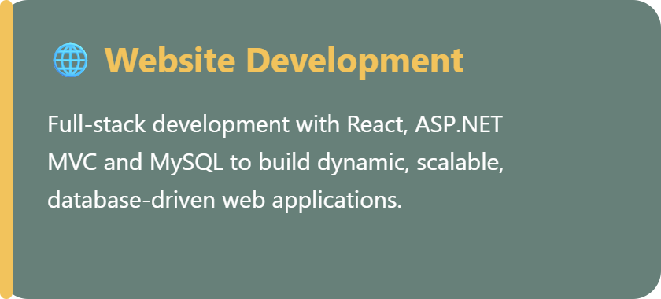
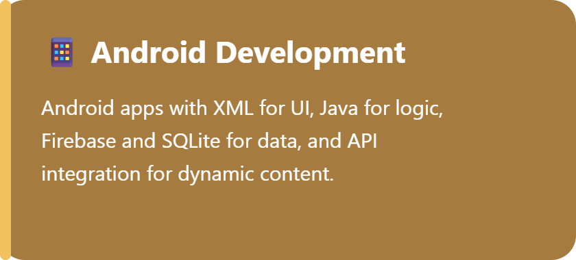
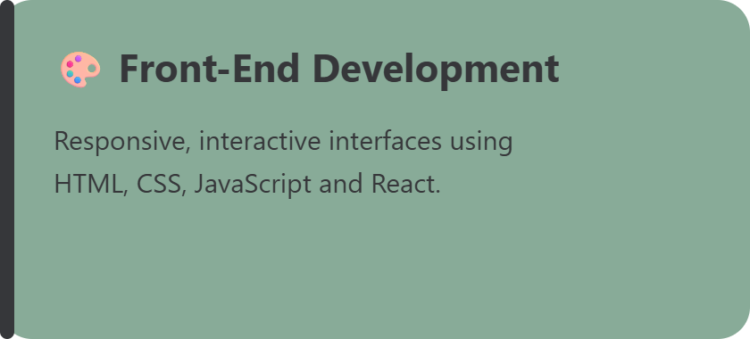

<!--
  ============================================================
  HAMNA AFIFA - GITHUB PROFILE README
  Palette: #678079 teal-grey | #88ab98 sage | #f2c35c gold | #a67b40 bronze | #36373a charcoal

  QUICK CHECKLIST - things you may need to change (search for "CHANGE"):
  1. Email address (2 places)            -> only if you want a different one
  2. LinkedIn URL (2 places)             -> already set from your resume, check it opens
  3. Featured Projects table             -> replace the 3 placeholder rows with real projects
  4. Card images (4 .svg files)          -> upload them to your repo first (see steps in chat)
  5. Optional: add Kaggle / Portfolio    -> copy a badge line and change the URL
  Your username "hamnaAf15" is already filled in everywhere.
  ============================================================
-->

  

<!-- CHANGE: LinkedIn URL (already taken from your resume - just check it opens your profile) -->

<!-- CHANGE: email address after "mailto:" (or delete this whole line to hide your email) -->

<!-- OPTIONAL: to add Kaggle or a portfolio, copy a line above and change the URL in the last brackets -->

 

Software Engineering graduate from **Sialkot, Pakistan**, with a strong foundation in **full-stack web development** and **Android app development**. I build responsive, data-driven applications using **React, ASP.NET MVC, SQL and Java**, and I enjoy turning design concepts into functional, user-friendly products.

- 🎓 **Bachelor of Software Engineering** (2022 – 2026)
- 🌐 Building full-stack apps with **React** and **ASP.NET MVC**
- 📱 Developing **Android apps** with Java, XML, Firebase and SQLite
- 🔐 Upskilling in **software design and security** through certifications
- 🚀 Participant in the **NASA Space Apps Challenge**

> *"Every project is a step forward. Every bug is a lesson. Every commit is growth."*

 

**Front-End**

**Back-End & Databases**

**Android & Languages**

**Tools**

 

  
  

  
  

 

**C++ Intern** · CodeAlpha · *Remote* · March 2024 – June 2024
- Completed a hands-on C++ internship focused on strengthening core programming and problem-solving skills through applied coding tasks and projects.

 

| Qualification | Years |
|---|---|
| 🎓 **Bachelor of Software Engineering** | 2022 – 2026 |
| 📘 FSc Pre-Engineering | 2019 – 2021 |
| 💻 Matriculation, Computer Science | 2017 – 2019 |

 

| Qualification | Years |
|:---:|:---:|
| 🎓 **Bachelor of Software Engineering** | 2022 – 2026 |
| 📘 FSc Pre-Engineering | 2019 – 2021 |
| 💻 Matriculation, Computer Science | 2017 – 2019 |

 

<!--
  CHANGE: replace each row below with one of your real projects.
  - Project name: change the text inside [**...**]
  - Link: change the URL inside (...) to your repo link, e.g. https://github.com/hamnaAf15/your-repo-name
  - Description and Tech: just edit the text
  Add more rows by copying a line, or delete rows you don't need.
-->

| Project | Description | Tech |
|---|---|---|
| [**Smart Vision Helmet**](https://github.com/hamnaAf15) | One line about what it does | React, ASP.NET MVC, MySQL |
| [**Smart City Traffic**](https://github.com/hamnaAf15) | One line about what it does | Java, XML, Firebase |
| [**Study Space Dashboard**]([https://github.com/hamnaAf15](https://github.com/hamnaAf15/studySpace-website)) | One line about what it does | C++ |

 

- **Now:** strengthening full-stack skills by building projects with React and ASP.NET MVC, and deepening knowledge of modern web design and database integration.
- **Next:** growing into a professional full-stack developer in a dynamic, innovative tech environment, contributing to impactful software projects.
- **Long term:** taking on a leadership role, mentoring others and managing development teams.

 

 

   
  💬 <i>Open to internships, collaborations, and full-stack or Android projects.</i>
    
  
   
  
    

