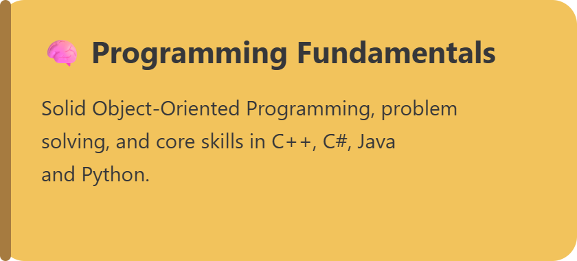

<!--
  ============================================================
  HAMNA AFIFA - GITHUB PROFILE README
  Palette: #678079 teal-grey | #88ab98 sage | #f2c35c gold | #a67b40 bronze | #36373a charcoal
  ============================================================
-->

  

 

Software Engineering graduate from **Sialkot, Pakistan**, with a strong foundation in **full-stack web development** and **Android app development**. I build responsive, data-driven applications using **React, ASP.NET MVC, SQL and Java**, and I enjoy turning design concepts into functional, user-friendly products.

- 🎓 **Bachelor of Software Engineering** (2022 – 2026)
- 🌐 Building full-stack apps with **React** and **ASP.NET MVC**
- 📱 Developing **Android apps** with Java, XML, Firebase and SQLite
- 🔐 Upskilling in **software design and security** through certifications
- 🚀 Participant in the **NASA Space Apps Challenge**

> *"Every project is a step forward. Every bug is a lesson. Every commit is growth."*

 

**Front-End**

**Back-End & Databases**

**Android & Languages**

**Tools**

 

  
  

  
  

 

**C++ Intern** · CodeAlpha · *Remote* · March 2024 – June 2024
- Completed a hands-on C++ internship focused on strengthening core programming and problem-solving skills through applied coding tasks and projects.

 

| Qualification | Years |
|:---:|:---:|
| **Bachelor of Software Engineering** | 2022 – 2026 |
| FSc Pre-Engineering | 2019 – 2021 |
| Matriculation, Computer Science | 2017 – 2019 |

 

| Project | Description | Tech |
|:---|:---|:---|
| [**Smart Vision Helmet**](https://appetize.io/app/b_crzkjkqbywxqglv2uwkylqnd2m?device=pixel7&osVersion=15.0&toolbar=true) | ESP32-based smart helmet with live YOLOv8 object detection and maps routing | Embedded C++, Android, Python |
| [**Study Space Dashboard**](https://hamnaaf15.github.io/studySpace-website/) | Multi-page academic repository system with React frontend & ASP.NET backend | React, ASP.NET Core, MySQL |
| [**Smart Traffic Management System**](https://hamnaaf15.github.io/smart-city-traffic-management/) | My first basic website | HTML, CSS |
| [**RADAR**]([https://radar-astrox.onrender.com)) |Visual health self-screening tool for deep-space astronauts, with color-coded risk scores (MHRI, NRI, BRI), 4-week mental health forecasts and Rh-negative profile analysis | Python, Flask, scikit-learn, pandas, NumPy, HTML, CSS |

 

- **Now:** strengthening full-stack skills by building projects with React and ASP.NET MVC, and deepening knowledge of modern web design and database integration.
- **Next:** growing into a professional full-stack developer in a dynamic, innovative tech environment, contributing to impactful software projects.
- **Long term:** taking on a leadership role, mentoring others and managing development teams.

 

 

   
  💬 <i>Open to internships, collaborations, and full-stack or Android projects.</i>
    
  
   
  
    
  <b><i>Keep Building. Keep Growing.</i></b>

